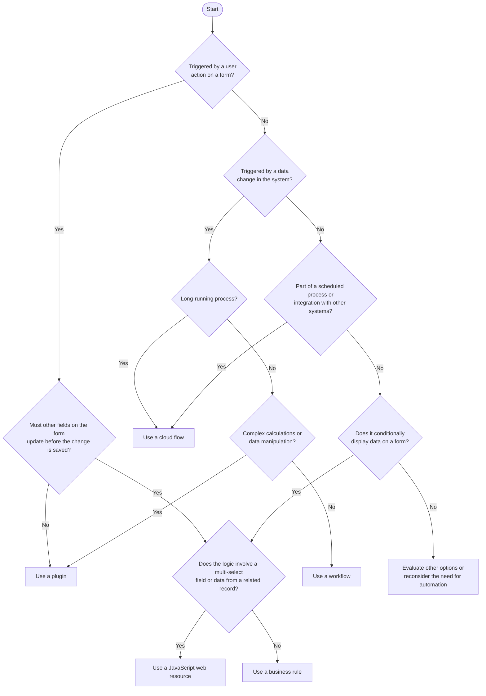

# Developer Guidelines

Conventions for designing Dataverse schema and logic in solutions built from this template. A condensed version is in each project's `AGENTS.md`, so AI agents follow the same rules.

## Choosing an implementation

Work through the tree to decide how to implement a piece of automation or business logic.



Notes:

- **Plugins** run synchronously inside the transaction (or asynchronously, if registered that way), so they can block a save with a validation error. Use them when the logic must run no matter how the data changes: forms, imports, integrations, or the API.
- **Business rules and JavaScript** only run on forms. Never rely on them alone to enforce data integrity.
- **Workflow** here means a classic real-time (synchronous) workflow, for simple no-code logic on a data change. For new asynchronous automation, Microsoft recommends cloud flows over classic background workflows.
- **Cloud flows** suit long-running, scheduled and integration work, where retries and connectors matter more than transactional consistency.
- Power Apps **code apps** are standalone apps, not form logic. Consider one when a model-driven form can't provide the experience you need.

## Naming conventions

### General

- Every table, column and relationship in a solution uses the solution publisher's prefix.
- **Schema names** are the prefix plus PascalCase: `cc_MyFieldName`. The **logical name** is the schema name in lowercase: `cc_myfieldname`.
- You can change a display name later. You **can't** change a schema or logical name without replacing the column, so choose carefully.
- Where no specific rule applies, use a clear, descriptive name.

### Columns

| Column type | Display name | Schema name (after the prefix) | Example |
|---|---|---|---|
| Date and time | Ends with **On** | `...On` | Created On → `CreatedOn` |
| Date only | Ends with **Date** | `...Date` | Policy Expiration Date → `PolicyExpirationDate` |
| Choice | Ends with **Code** or **Type** | `...Code` / `...Type` | Claim Type → `ClaimType` |
| Lookup | The related table's name | Ends with **Id** | Account → `AccountId`. When there are several lookups to the same table, qualify the name: `EmployerAccountId`, `InsurerAccountId`. |
| Whole/decimal number used as an identifier | Ends with **Number** | `...Number` | Claim Number → `ClaimNumber` |
| Image | Ends with **Image** | `...Image` | Entity Image → `EntityImage` |
| Phone | Ends with **Phone** | `...Phone` | Main Phone → `MainPhone` |
| URL | Ends with **Url** | `...Url` | Photo URL → `PhotoUrl` |
| Yes/No | Plain description | Starts with **Is** | Stock Item → `IsStockItem` |
| Email | Plain description | Ends with **EmailAddress** (or **Email**) | Business Email → `BusinessEmailAddress` |
| Duration | Plain description | Ends with **Minutes** | Scheduled Duration → `ScheduledDurationMinutes` |
| Time zone | Ends with **Offset** | `...Offset` | UTC Offset → `UtcOffset` |

### Relationships (one-to-many)

Dataverse suggests a relationship name when you create a lookup. Keep the suggestion when it follows this pattern, which names both tables and the lookup that connects them:

```
<prefix>_<referencing table logical name>_<LookupFieldSchemaName>_<referenced table logical name>
```

With prefix `cc`, a lookup `cc_VendorAccountId` on table `cc_project` pointing to `account`:

```
cc_project_VendorAccountId_account
```

A lookup `cc_CurrentProjectId` on `account` pointing to `cc_project`:

```
cc_account_CurrentProjectId_cc_project
```

The prefix isn't repeated for the referencing table when it matches the publisher prefix, but it is kept on the referenced table.

### Early-bound proxies

Generated proxy classes use the PascalCase prefix: prefix `cc` → `CcProject`. Fields are exposed as `CcProject.Fields.<FieldName>` constants and choice values as `CcProject.e<FieldName>` enums. See the project's `AGENTS.md`.
